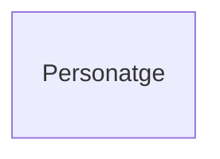
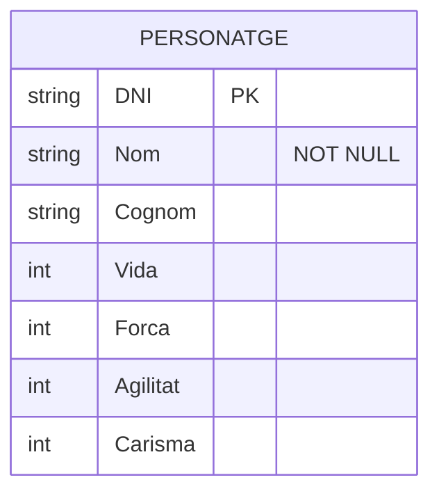
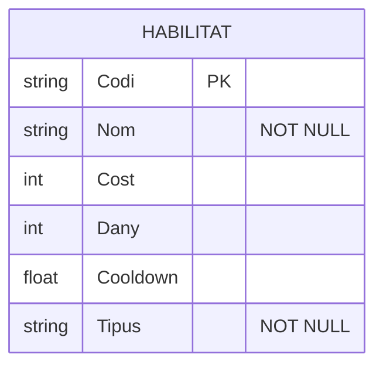
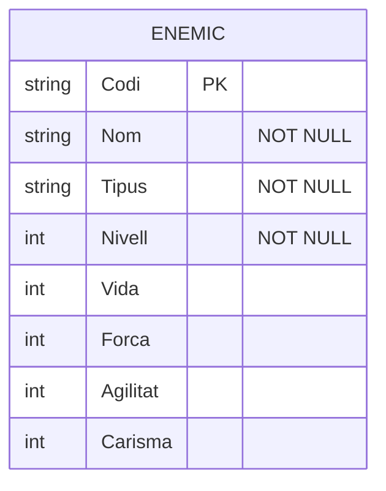
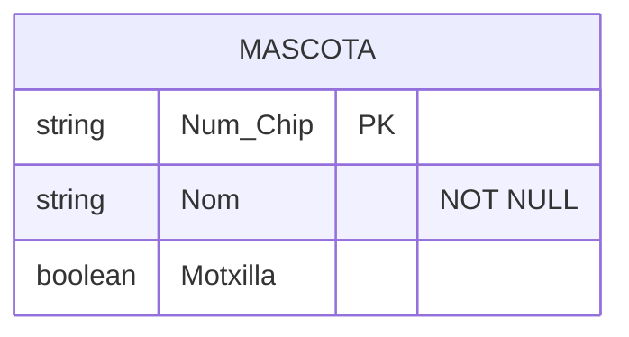
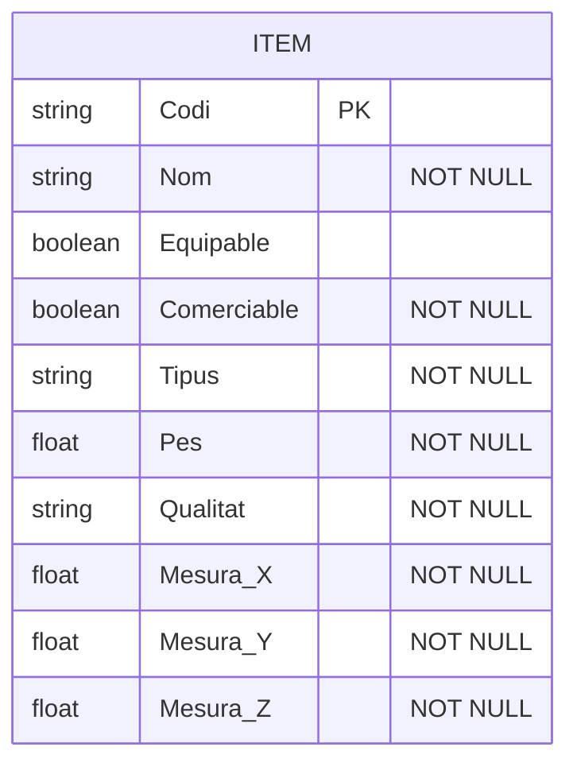
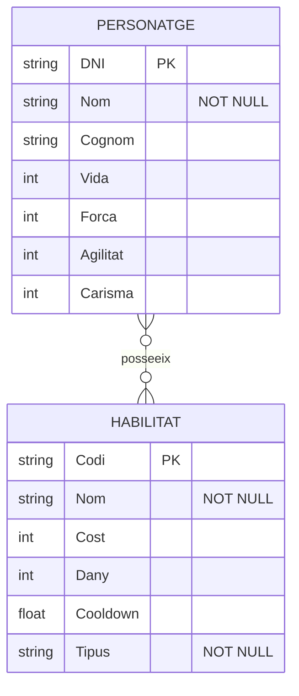
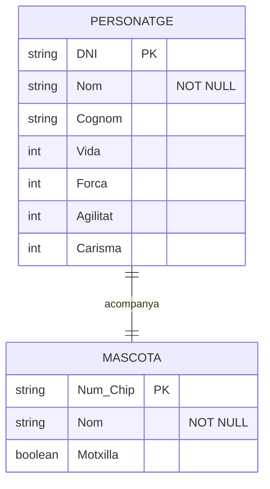
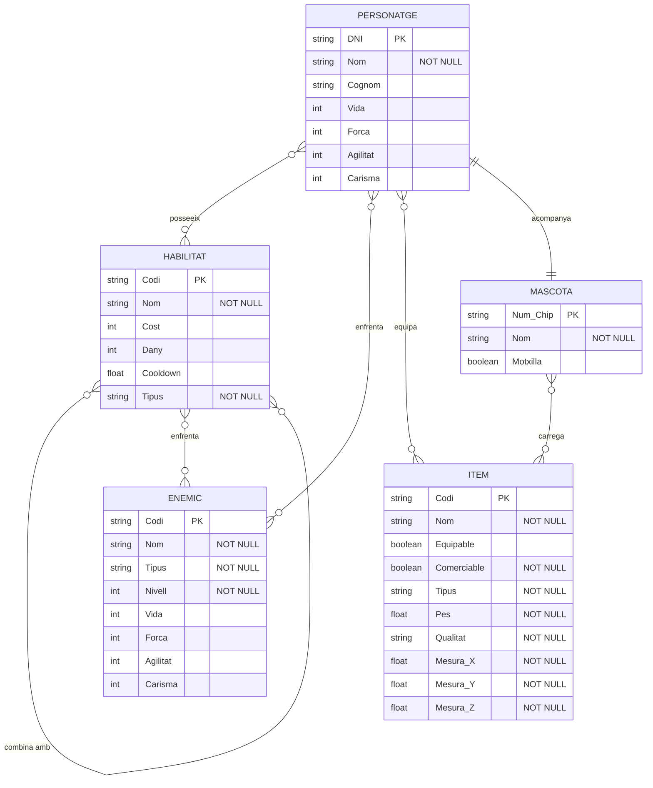

# Model E/R (en Mermaid)


## Per fer el diagrama primer cal crear l'entitat que connecta tot: ```Personatge```.



### Li afegim el atributs que tindra el ```Personatge```
    
> ```PK```: Clau Primaria (Atribut Identificador).
>
> ```"NOT NULL"```: Ha de tenir un valor obligatoriament (Atributs no nul).

### Cada **Atribut** ha de tenir un tipus de dada.
    
> ```string```: Text literal.
> 
> ```int```: Nombre sencer.
> 
> ```float```: Nombre amb decimals.
> 
> ```boolean```: Vertader o Fals.



Repetim aquest procés fins a tenir totes les entitats creades:

```Habilitat```



```Enemic```



```Mascota```



```Item```



### **Relacions** utilitzats en aquesta diagrama:

Relació Molts a Molts (M:N), és representa amb ```}o-```



Relació Un a Un (1:1), és representa amb ```||-```



Ara li afegim les relacions que tenen entre ```Personatge```, ```Habilitat```, ```Mascota```, ```Enemic```, ```Item```


